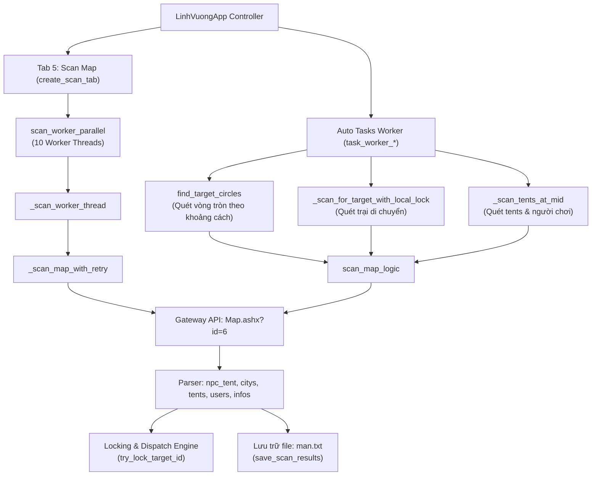
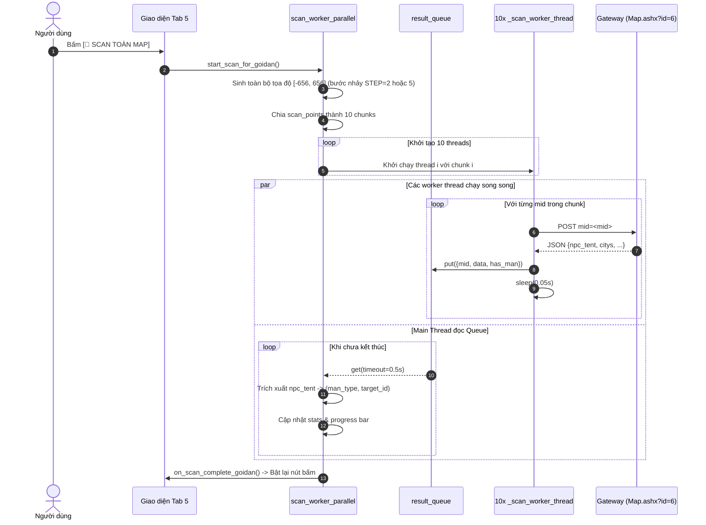

# Tài Liệu Kỹ Thuật: Cơ Chế Tìm Kiếm & Quét Bản Đồ Trong ZMan.exe

## 1. Tổng Quan Kiến Trúc (Architecture Overview)

Trong phần mềm [`ZMan.exe`](file:///d:/Tools/rea/ZMan.exe) (controller chính: class `LinhVuongApp` với hơn 387 phương thức được biên dịch từ `ZMan.py`), cơ chế **Tìm Kiếm / Quét (Search & Scan)** là nền tảng cốt lõi phục vụ các tính năng tự động:
* **Gọi Dân / Gọi Vong Linh**: Tìm kiếm vị trí trống hoặc quái Man / Vong Linh để tấn công hoặc triệu hồi.
* **Bình Man & Trại Di Chuyển**: Quét mục tiêu Man xung quanh thành hoặc doanh trại lưu động theo bán kính, tự động dời trại từng bước tới mục tiêu.
* **Thảo Phạt**: Phát hiện các cứ điểm dã ngoại, quân cướp theo cấp độ.
* **Tầm Bảo & Trinh Sát**: Định vị mục tiêu map ID và trinh sát trại (`tents`) / người chơi (`users`).



---

## 2. Toán Học Tọa Độ & Không Gian Bản Đồ (Map Coordinate Geometry)

Thế giới Linh Vương được chia thành một lưới tọa độ 2D phẳng hình vuông có tâm là $(0, 0)$:
* **Phạm vi tọa độ**:
  $$X \in [-656, 656], \quad Y \in [-656, 656]$$
* **Kích thước một cạnh**: $656 - (-656) + 1 = 1.313$ ô.
* **Tổng số ô bản đồ**:
  $$1.313 \times 1.313 = 1.723.969 \text{ ô}$$
* **Hệ số dịch chuyển tâm (Offset)**:
  Tọa độ $(0, 0)$ ứng với Map ID $\text{mid} = 861.985$.

### 2.1 Công Thức Chuyển Đổi Tọa Độ sang Map ID (`get_mid_from_coords`)
$$\text{mid} = y \times 1.313 + x + 861.985$$

*Ví dụ kiểm chứng:*
* $x = -656, y = -656 \implies \text{mid} = (-656) \times 1313 + (-656) + 861985 = 1$
* $x = 0, y = 0 \implies \text{mid} = 0 + 0 + 861985 = 861.985$
* $x = 656, y = 656 \implies \text{mid} = 656 \times 1313 + 656 + 861985 = 1.723.969$

### 2.2 Công Thức Chuyển Đổi Map ID sang Tọa Độ (`get_coords_from_mid`)
$$x = ((\text{mid} - 1) \pmod{1313}) - 656$$
$$y = \lfloor(\text{mid} - 1) / 1313\rfloor - 656$$

---

## 3. Chi Tiết Giao Thức & Luồng API (API Protocol Specification)

Tất cả các thao tác quét bản đồ đều giao tiếp qua endpoint duy nhất: **`Map.ashx?id=6`**.

### 3.1 HTTP Request Specification

| Thuộc tính | Giá trị |
| :--- | :--- |
| **URL Endpoint** | `http://sg<server_id>.dipan.com/GateWay/Map.ashx?id=6` |
| **Phương thức** | `POST` |
| **Mã hóa Payload** | `application/x-www-form-urlencoded; charset=UTF-8` |
| **Timeout mặc định** | 30 giây |
| **Max Retries** | 15 lần (trong `safe_api_call`) hoặc 3–5 lần (trong `_scan_map_with_retry`) |
| **Retry Backoff** | Khi gặp HTTP `503 Service Unavailable`, tự động `sleep(0.5 * attempt)` và thử lại |

#### Raw Request Headers
```http
POST /GateWay/Map.ashx?id=6 HTTP/1.1
Host: sg53.dipan.com
User-Agent: Mozilla/5.0 (Windows NT 10.0; Win64; x64) AppleWebKit/537.36 (KHTML, like Gecko) Chrome/120.0.0.0 Safari/537.36
Accept: text/javascript, text/html, application/xml, text/xml, */*
X-Prototype-Version: 1.5.0
X-Requested-With: XMLHttpRequest
Content-Type: application/x-www-form-urlencoded; charset=UTF-8
Origin: http://sg53.dipan.com
Referer: http://sg53.dipan.com/
Cookie: uid=123456; uname=MyPlayerName
```

#### Raw Request Body
```url-encoded
mid=861985&_=
```
* `mid`: Map ID tại tâm vùng quét (integer). Mỗi viewport trả về ma trận ô xung quanh `mid` (bán kính hiển vi khoảng 12 ô xung quanh).
* `_`: Chuỗi rỗng hoặc timestamp để tránh HTTP cache của trình duyệt/proxy.

---

### 3.2 Gateway Response Specification

Phản hồi từ máy chủ game là một JSON Object chứa các mảng thực thể nằm trong viewport:

```json
{
  "citys": [
    [1024, "Lạc Dương", 6, 861985]
  ],
  "infos": [
    [861985, 1024, 1]
  ],
  "npc_tent": [
    [9876543, 7, 862010],
    [9876544, 301, 862025]
  ],
  "tents": [
    [501, 2048, 861995]
  ],
  "users": [
    [2048, "ChiếnThần", 100, "BáVương"]
  ]
}
```

#### Bảng Ánh Xạ Chỉ Số Phần Tử (Array Element Mapping)

#### A. Mảng `npc_tent` (Trại Quái Man / Vong Linh)
| Chỉ số | Tên thuộc tính | Kiểu | Ý nghĩa trong ZMan.exe |
| :--- | :--- | :--- | :--- |
| `npc[0]` | `target_id` | `int` | ID đối tượng duy nhất trên server dùng để xuất quân tấn công (`OPT.ashx?id=53`) hoặc gọi dân (`OPT.ashx?id=69`). |
| `npc[1]` | `man_type` | `int` | Mã loại Man (1..10, 301) tra cứu trong `man_id_map`. |
| `npc[2]` | `m_mid` | `int` | Map ID vị trí trại. Dùng `get_coords_from_mid` để lấy tọa độ `(tx, ty)`. |

#### B. Mảng `users` (Thông tin người chơi trong vùng)
| Chỉ số | Tên thuộc tính | Kiểu | Ý nghĩa |
| :--- | :--- | :--- | :--- |
| `user[0]` | `user_id` | `int` | ID người chơi sở hữu thành/trại |
| `user[1]` | `player_name` | `str` | Tên nhân vật |
| `user[2]` | `alliance_id` | `int` | ID bang hội |
| `user[3]` | `alliance_name`| `str` | Tên bang hội |

#### C. Mảng `citys` (Thành trì & Thiên thành)
| Chỉ số | Tên thuộc tính | Kiểu | Ý nghĩa |
| :--- | :--- | :--- | :--- |
| `city[0]` | `city_id` | `int` | ID thành trì |
| `city[1]` | `city_name` | `str` | Tên thành |
| `city[2]` | `city_level`| `int` | Cấp độ thành. Cấp `5` và `6` là **Thiên Thành** (bị loại trừ khỏi phạm vi đánh Man). |
| `city[3]` | `mid` | `int` | Map ID của thành |

#### D. Mảng `tents` (Doanh trại người chơi)
| Chỉ số | Tên thuộc tính | Kiểu | Ý nghĩa |
| :--- | :--- | :--- | :--- |
| `tent[0]` | `tent_id` | `int` | ID của doanh trại |
| `tent[1]` | `user_id` | `int` | ID người chơi sở hữu trại |
| `tent[2]` | `mid` | `int` | Vị trí đóng trại |

---

## 4. Bảng Phân Loại Man & Mục Tiêu (`man_id_map`)

Được trích xuất trực tiếp từ các hằng số Tuple `(1, 2, 3, 4, 5, 6, 7, 8, 9, 10, 301)` trong `LinhVuongApp.__init__`:

| `man_type` | Tên hiển thị Tiếng Việt | Danh mục | Đặc điểm / Lưu ý |
| :---: | :--- | :--- | :--- |
| **1** | **Uy Quốc** | Man Tộc | Mục tiêu cơ bản |
| **2** | **Tiên Ti** | Man Tộc | Man dã ngoại |
| **3** | **Ô Hoàn** | Man Tộc | Man dã ngoại |
| **4** | **Sơn Việt** | Man Tộc | Man dã ngoại |
| **5** | **Khương Để** | Man Tộc | Man dã ngoại |
| **6** | **Mạnh Hoạch** | Man Tộc | Man Nam Man |
| **7** | **Hung Nô** | Man Tộc | Man cấp cao, nhiều tài nguyên / EXP |
| **8** | **Đột Quyết** | Man Tộc | Kỵ binh mạnh |
| **9** | **Long Phi** | Man Tộc | Boss / Cứ điểm cao cấp |
| **10** | **Hổ Báo Kỵ** | Man Tộc | Kỵ binh tinh nhuệ |
| **301** | **Vong Linh** | Sự Kiện / Đặc Biệt | Quái sự kiện gọi dân đặc biệt |

---

## 5. Thiết Kế Giao Diện Tab 5: Scan Map (`create_scan_tab`)

Giao diện Tab 5 được dựng bằng Tkinter thuần với bố cục:

```
+-------------------------------------------------------------------------------+
| [Tab 5: Scan Map - Tiện ích quét cho Gọi Man]                                 |
|                                                                               |
| [🚀 SCAN TOÀN MAP (Green)]               [⏹️ DỪNG SCAN (Red Disabled)]         |
|                                                                               |
| +--- Thống kê quét ---------------------------------------------------------+ |
| | Tổng số Man: [ 0 ]                Tiến trình: [ 0% ]                      | |
| | [============================= Progressbar =============================] | |
| +---------------------------------------------------------------------------+ |
|                                                                               |
| +--- Phân loại Man ---------------------------------------------------------+ |
| | [Canvas + Scrollbar danh sách phân loại số lượng theo từng loại man]      | |
| | - Hung Nô: 154 mục tiêu                                                   | |
| | - Vong Linh: 42 mục tiêu                                                  | |
| | - Khương Để: 89 mục tiêu                                                  | |
| +---------------------------------------------------------------------------+ |
|                                                                               |
| [💾 Lưu kết quả quét (#17a2b8)]             [📂 Load kết quả quét (#6c757d)]  |
+-------------------------------------------------------------------------------+
```

### 5.1 Cấu Hình Màu Sắc & Font Chữ
* Nút bắt đầu: `bg="#28a745"`, `fg="white"`, `font=('Arial', 10, 'bold')`.
* Nút dừng: `bg="#dc3545"`, `fg="white"`, trạng thái ban đầu `state="disabled"`.
* Tiến trình: `ttk.Progressbar(mode="determinate", length=350)`.
* File lưu trữ mặc định: [`man.txt`](file:///d:/Tools/rea/man.txt) (định dạng CSV: `man_type,target_id`).

---

## 6. Luồng Xử Lý & Logic Loop (Execution Logic & Algorithms)

### 6.1 Luồng 1: Quét Toàn Bản Đồ Song Song 10 Thread (`scan_worker_parallel`)



### 6.2 Luồng 2: Quét Vòng Tròn Theo Khoảng Cách (`find_target_circles`)

Hàm này tìm mục tiêu gần nhất để điều động tướng đi đánh ngay lập tức:

1. **Dọn dẹp Lock cũ**: Gọi `cleanup_expired_target_locks()`.
2. **Kiểm tra Thiên Thành**: Nếu người dùng bật `skip_around_capital`, quét trước các thành cấp $\ge 5$ để lấy toàn bộ `mid` nằm trong bán kính thiên thành và đưa vào danh sách đen `skip_capital_mids`.
3. **Tạo lưới tọa độ xung quanh gốc**:
   * Chạy $X$ từ $x_0 - r$ đến $x_0 + r$, $Y$ từ $y_0 - r$ đến $y_0 + r$ với bước nhảy `STEP = 5`.
   * Tính khoảng cách Euclide: $d = \sqrt{(x - x_0)^2 + (y - y_0)^2}$.
   * Nếu $d \le \text{radius}$: lưu `(d, x, y, mid)`.
4. **Sắp xếp theo thứ tự ưu tiên gần nhất**:
   * Gọi `scan_points.sort(key=lambda item: item[0])`.
5. **Duyệt tuần tự từng điểm quét**:
   * Gửi `POST` tới `Map.ashx?id=6` lấy dữ liệu. `sleep(0.15s)` giữa các điểm.
   * Lọc `npc` trong `npc_tent`:
     * Lấy `target_id = npc[0]`, `m_type = npc[1]`, `m_mid = npc[2]`.
     * Tính `tx, ty = get_coords_from_mid(m_mid)`.
     * Kiểm tra `m_type in target_types`.
     * Kiểm tra khóa: `not is_targetid_locked_for_ret230(target_id)` và `not is_coordinate_locked(tx, ty)`.
     * Khóa mục tiêu bằng `try_lock_target_id(target_id, task_id)`.
     * Trả về mục tiêu đầu tiên hợp lệ `(tx, ty, target_id)` để xuất quân!

---

## 7. Mã Nguồn Trích Xuất & Tái Cấu Trúc (Extracted & Reconstructed Code)

Dưới đây là mã nguồn Python tái lập 100% logic từ bytecode đã dịch ngược trong `ZMan`:

```python
"""
Reconstructed Map Scanning & Search Subsystem from ZMan.exe
Target: Linh Vương SLG Web Game Gateway
"""

import math
import time
import queue
import threading
from typing import Dict, Any, List, Tuple, Optional, Set
import requests

# Bảng mã loại Man chuẩn của Linh Vương
MAN_ID_MAP: Dict[int, str] = {
    1: "Uy Quốc",
    2: "Tiên Ti",
    3: "Ô Hoàn",
    4: "Sơn Việt",
    5: "Khương Để",
    6: "Mạnh Hoạch",
    7: "Hung Nô",
    8: "Đột Quyết",
    9: "Long Phi",
    10: "Hổ Báo Kỵ",
    301: "Vong Linh",
}

class MapScanEngine:
    def __init__(self, server_id: int, session: requests.Session):
        self.server_id = server_id
        self.session = session
        self.locked_targets: Dict[int, float] = {}  # target_id -> timestamp
        self.locked_ret230: Dict[int, float] = {}   # target_id -> timestamp
        self.lock = threading.Lock()
        self.stop_event = threading.Event()

    # =========================================================================
    # 1. TOÁN HỌC TỌA ĐỘ
    # =========================================================================

    @staticmethod
    def get_mid_from_coords(x: int, y: int) -> int:
        """Chuyển đổi tọa độ (x, y) sang Map ID."""
        return int(y) * 1313 + int(x) + 861985

    @staticmethod
    def get_coords_from_mid(mid: int) -> Tuple[int, int]:
        """Chuyển đổi Map ID sang tọa độ (x, y)."""
        idx = int(mid) - 1
        x = (idx % 1313) - 656
        y = (idx // 1313) - 656
        return x, y

    def get_headers(self) -> Dict[str, str]:
        return {
            "Host": f"sg{self.server_id}.dipan.com",
            "User-Agent": "Mozilla/5.0 (Windows NT 10.0; Win64; x64) AppleWebKit/537.36",
            "Accept": "text/javascript, text/html, application/xml, text/xml, */*",
            "X-Prototype-Version": "1.5.0",
            "X-Requested-With": "XMLHttpRequest",
            "Content-Type": "application/x-www-form-urlencoded; charset=UTF-8",
            "Origin": f"http://sg{self.server_id}.dipan.com",
            "Referer": f"http://sg{self.server_id}.dipan.com/",
        }

    # =========================================================================
    # 2. GIAO TIẾP MẠNG CÓ RETRY KHI GẶP 503
    # =========================================================================

    def scan_map_with_retry(self, mid: int, max_retries: int = 3) -> Optional[Dict[str, Any]]:
        """Quét map tại MID cụ thể - xử lý retry khi gặp HTTP 503."""
        url = f"http://sg{self.server_id}.dipan.com/GateWay/Map.ashx?id=6"
        data = {"mid": str(mid), "_": ""}
        headers = self.get_headers()

        for attempt in range(max_retries):
            if self.stop_event.is_set():
                return None
            try:
                resp = self.session.post(url, data=data, headers=headers, timeout=30)
                if resp.status_code == 503:
                    wait_time = 0.5 * (attempt + 1)
                    time.sleep(wait_time)
                    continue
                if resp.status_code == 200:
                    return resp.json()
            except Exception:
                time.sleep(0.5)
        return None

    # =========================================================================
    # 3. QUÉT VÒNG TRÒN ƯU TIÊN GẦN NHẤT (find_target_circles)
    # =========================================================================

    def find_target_circles(
        self,
        origin_x: int,
        origin_y: int,
        radius: int,
        target_types: List[int],
        skip_capital_radius: int = 0
    ) -> Optional[Tuple[int, int, int, int]]:
        """
        Quét vòng tròn từ tâm (origin_x, origin_y) trong bán kính radius.
        Trả về: (tx, ty, target_id, man_type) của mục tiêu gần nhất.
        """
        API_SCAN_SIZE = 12
        STEP = 5
        min_x = max(-656, origin_x - radius)
        max_x = min(656, origin_x + radius)
        min_y = max(-656, origin_y - radius)
        max_y = min(656, origin_y + radius)

        # 1. Thu thập tất cả các điểm quét nằm trong đường tròn
        candidate_points = []
        for x in range(min_x, max_x + 1, STEP):
            for y in range(min_y, max_y + 1, STEP):
                dist = math.sqrt((x - origin_x)**2 + (y - origin_y)**2)
                if dist <= radius:
                    mid = self.get_mid_from_coords(x, y)
                    candidate_points.append((dist, x, y, mid))

        # 2. Sắp xếp tăng dần theo khoảng cách (tìm gần nhất trước)
        candidate_points.sort(key=lambda item: item[0])

        # 3. Quét tuần tự từng điểm
        for dist, cx, cy, mid in candidate_points:
            if self.stop_event.is_set():
                return None

            data = self.scan_map_with_retry(mid)
            time.sleep(0.15)  # Delay tránh spam server

            if not data or "npc_tent" not in data:
                continue

            for npc in data["npc_tent"]:
                target_id = int(npc[0])
                m_type = int(npc[1])
                m_mid = int(npc[2])
                tx, ty = self.get_coords_from_mid(m_mid)

                # Kiểm tra loại mục tiêu người dùng yêu cầu
                if m_type not in target_types:
                    continue

                # Kiểm tra khóa mục tiêu
                with self.lock:
                    now = time.time()
                    if target_id in self.locked_targets and now - self.locked_targets[target_id] < 300:
                        continue
                    if target_id in self.locked_ret230 and now - self.locked_ret230[target_id] < 600:
                        continue
                    # Khóa mục tiêu để task khác không đánh trùng
                    self.locked_targets[target_id] = now

                return tx, ty, target_id, m_type

        return None
```

---

## 8. Ví Dụ Chạy Độc Lập (Ready-to-Run Code Sample)

Đoạn mã hoàn chỉnh sau có thể được thực thi độc lập để kiểm tra quét bản đồ thực tế hoặc mô phỏng:

```python
import sys
import requests
from dataclasses import dataclass
from typing import List

@dataclass
class DiscoveredMan:
    target_id: int
    man_type: int
    man_name: str
    x: int
    y: int
    mid: int

def scan_linhvuong_map(server_id: int, center_x: int, center_y: int, radius: int = 10) -> List[DiscoveredMan]:
    session = requests.Session()
    # Công thức tọa độ
    center_mid = center_y * 1313 + center_x + 861985
    url = f"http://sg{server_id}.dipan.com/GateWay/Map.ashx?id=6"
    
    headers = {
        "Host": f"sg{server_id}.dipan.com",
        "User-Agent": "Mozilla/5.0",
        "X-Requested-With": "XMLHttpRequest",
        "Content-Type": "application/x-www-form-urlencoded; charset=UTF-8",
    }
    
    print(f"[*] Quét bản đồ S{server_id} tại ({center_x}, {center_y}) -> MID: {center_mid}")
    resp = session.post(url, data={"mid": str(center_mid), "_": ""}, headers=headers, timeout=15)
    
    if resp.status_code != 200:
        print(f"[-] Lỗi HTTP {resp.status_code}")
        return []

    data = resp.json()
    results = []
    
    for npc in data.get("npc_tent", []):
        tid = int(npc[0])
        m_type = int(npc[1])
        m_mid = int(npc[2])
        
        # Giải mã tọa độ từ mid
        idx = m_mid - 1
        tx = (idx % 1313) - 656
        ty = (idx // 1313) - 656
        
        name = MAN_ID_MAP.get(m_type, f"Man Loại {m_type}")
        results.append(DiscoveredMan(tid, m_type, name, tx, ty, m_mid))
        print(f"[+] Tìm thấy: {name} (ID: {tid}) tại ({tx}, {ty})")
        
    return results

if __name__ == "__main__":
    # Test mẫu với tọa độ (0, 0)
    print("Demo module quét bản đồ Linh Vương ZMan")
    mid_sample = 861985
    idx = mid_sample - 1
    print(f"Kiểm tra tọa độ mid 861985: x={(idx % 1313) - 656}, y={(idx // 1313) - 656}")
```

---

## 9. Tổng Kết

| Đặc tính | Chi tiết kỹ thuật trích xuất từ ZMan.exe |
| :--- | :--- |
| **Endpoint duy nhất** | `http://sg<sv>.dipan.com/GateWay/Map.ashx?id=6` |
| **Tham số gửi lên** | `mid=<int>&_=` |
| **Công thức tọa độ** | $\text{mid} = y \times 1313 + x + 861985$ |
| **Khóa chống trùng** | Quản lý bằng `self.locked_targets` (TTL 300s) và `self.locked_ret230` (TTL 600s) |
| **Tránh Thiên Thành** | Loại bỏ các thành có `city_level >= 5` trong danh sách `citys` |
| **Tệp lưu trữ** | [`man.txt`](file:///d:/Tools/rea/man.txt) định dạng CSV: `<man_type>,<target_id>` |
